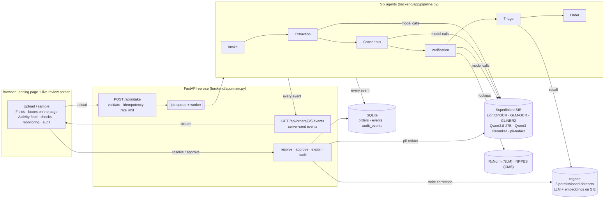

# PillSpark: read the fax, flag the doubt, never guess

> **Decision support only. A licensed pharmacist must review every order.** The demo document is a real handwritten
> chemotherapy chart with the patient's name and registration number removed from the image itself.

PillSpark is a real-time intake system for pharmacies. Upload a faxed or photographed prescription or medication chart,
and six agents turn it into a structured order **on open models served by [Superlinked SIE](https://superlinked.com/serverless)**.
Every field PillSpark isn't sure of goes to a pharmacist with the reason, the candidate values, the OCR text it came from
and a box on the page showing where it was read. Pharmacist corrections become shared memory in
**[cognee](https://docs.cognee.ai)**, so the agents learn, but memory can never mark anything as verified.

Built for LOCALHOST NYC (2026-11-07) on top of the original [PillSpark](https://github.com/AUW160150/PillSpark) prototype.
The model layer moved from a hosted gateway to open models on SIE, and the old tracing sponsor was removed.

**Contents:** [What it does](#what-it-does) · [How Superlinked SIE is used](#how-superlinked-sie-is-used) ·
[How cognee is used](#how-cognee-is-used) · [Architecture](#architecture) · [Safety invariant](#the-safety-invariant-guesses--0) ·
[Run it](#run-it) · [API](#api) · [Verification](#how-it-was-verified) · [Limitations](#limitations) ·
**Detailed task architecture: [docs/ARCHITECTURE.md](docs/ARCHITECTURE.md)**

---

## What it does

| Step | What happens |
|---|---|
| **Intake** | Drag-and-drop upload (JPEG, PNG, WebP up to 15 MB) or the sample chart. Idempotency key, type and size checks, image-quality score. |
| **Live review** | The six agents stream every step to the browser over server-sent events: stages, model calls with latency and credits, registry lookups, safety checks, memory reads and writes, audit entries. |
| **Fields** | Order fields (patient, diagnosis, regimen, body surface area, prescriber, NPI) plus one group per medication row (drug, dose, directions, date). Each field has a value, confidence, status, reasons, candidates, OCR evidence and a location box. |
| **Statuses** | `verified` (two independent readers agree and every check passes), `needs_review`, `unreadable` (the value is withheld), `missing`. |
| **Pharmacist** | Click a candidate or enter a value, with a reason required. J and K move between flags, Enter accepts. Approve stays locked until nothing is flagged. |
| **Exports** | JSON, CSV and an HL7 FHIR R4 `Bundle` of `MedicationRequest` resources, for approved orders only. |
| **Audit** | An append-only `audit_events` table records every field decision, resolution, approval and export, with actor, time, before and after. |

What it caught on the demo chart in live runs:
- **The second drug:** GLM-OCR read it as **"cytoxan"** (cyclophosphamide) while LightOnOCR read **"Cytosar"** (cytarabine). The lines stay flagged.
- **The prescriber:** an OCR model invented names ("Dr. Smith") from illegible signatures. The value is withheld as unreadable.
- **Directions:** infusion time is 24 h on some days and 22 h on another. Flagged.
- **Dose range:** the body surface area is blank, so the mg/m² check is **paused** (not skipped) for daunorubicin and cytarabine.

---

## How Superlinked SIE is used

Every model job runs on an **open model served by Superlinked SIE** through the `sie-sdk` Python client. No frontier model is
in the pipeline. Each job is one line in [`backend/models.yaml`](backend/models.yaml), so swapping a model is a one-line change:

| Agent job | SIE model | SIE call | What it may do |
|---|---|---|---|
| OCR reader 1 (page to Markdown) | `lightonai/LightOnOCR-3-4B` | `extract(model, Item(images=[png]))` | Produce a transcript |
| OCR reader 2 (independent) | `zai-org/GLM-OCR` | `extract(...)` | Produce a second transcript |
| Order-field tagging | `fastino/gliner2-large-v1` | `extract(..., output_schema=...)` on 170-word windows | Vote on order fields |
| Structured parse (image + one transcript) | `Qwen/Qwen3.8-27B-FP8` | `chat_completions(..., response_format=json_schema strict)` ×2, one per transcript | Vote on every field |
| Locating fields on the page | `Qwen/Qwen3.8-27B-FP8` | `chat_completions` with a strict box schema (0–1000 coordinates) | Draw evidence boxes; **never** changes a status |
| Ranking drug candidates | `Qwen/Qwen3-Reranker-0.6B` | `score(model, query, items)` | **Order** RxNorm candidates against the OCR line (ranking only) |
| PII redaction before memory | `superlinked/pii-redact` | `extract(..., labels=[...])` | Strip identifiers from correction text |
| cognee's own LLM and embeddings | `Qwen/Qwen3.8-27B-FP8`, `BAAI/bge-m3` | SIE's OpenAI-compatible `/v1` endpoints | Build cognee's knowledge graph |

**Why two OCR readers, each feeding its own Qwen parse:** disagreement between independent readers is the strongest
signal that handwriting is ambiguous. A field can only be verified when readings built on **both** transcripts agree. Any
disagreement becomes a reason a pharmacist can see; PillSpark never silently picks one.

**Observed on the demo chart (2026-11-07, SIE Serverless):**

| Call | Latency | SIE credits per call |
|---|---|---|
| LightOnOCR | 7–9 s | 142 |
| GLM-OCR | 2–5 s | 25 |
| Qwen structured parse (two run in parallel) | 19–29 s | 393–673 |
| GLiNER2 per window | 0.2–0.6 s | 2–6 |
| Qwen locate fields | ~11 s | 269–288 |
| Qwen3-Reranker per drug line | 0.14–0.36 s | 1 |
| pii-redact per correction | 0.3 s warm (about 15 s cold start) | 1 |
| **Whole document, end to end** | **35–45 s** | **~1,050–1,360** |

Credits are as SIE reports them per request. The benchmark against a frontier baseline (Milestone 2) is not run yet, and
the UI shows "not run" rather than invented numbers.

**What we learned about SIE** (also in [docs/ARCHITECTURE.md](docs/ARCHITECTURE.md#sie-integration-notes)):
- OCR models return the page as a single `markdown` entity with **no bounding boxes**, so locations come from a separate Qwen grounding call.
- Qwen3.8-27B on Serverless has an **8,192-token window** and counts an image as about 3,136 tokens at any size. The parse output must fit in about 2,800 tokens, so reading and locating are two separate calls.
- `zai-org/GLM-5.3-Flash` doesn't declare `json_schema` support on SIE, so cognee uses Qwen3.8-27B instead.
- GLiNER2 answers "nothing found" with HTTP 500. PillSpark treats that as an empty result, as the cookbook does.

---

## How cognee is used

cognee is the **shared memory between agents and pharmacists**, running in multi-user mode with dataset permissions
(`ENABLE_BACKEND_ACCESS_CONTROL=true`). Its LLM and embeddings both run on SIE.

| Dataset | Owner | Who can write | Who can read | What goes in |
|---|---|---|---|---|
| `pharmacist_corrections` | `pharmacist` | pharmacist only | every agent and role | Field, each model's raw reading, final value, redacted reason, prescriber |
| `prescriber_patterns` | `verification-agent` | verification-agent | everyone | Prescriber-level handwriting and prescribing patterns |
| `agent_notes` | `triage-agent` | every agent | everyone | Agent failure notes, e.g. "the readers disagreed on this handwritten drug name" |

Users: `extraction-agent`, `verification-agent`, `triage-agent`, `pharmacist`, `technician`, created with
`create_user`. Datasets come from `create_authorized_dataset`, and grants from `give_permission_on_dataset`. **cognee
enforces the permissions itself.** A technician's write to `pharmacist_corrections` is refused with cognee's
`PermissionDeniedError` (403), which was tested.

**The learning loop:**
1. A pharmacist resolves a flag with a reason.
2. **PHI guard:** patient fields are stripped structurally, and the reason text goes through SIE `pii-redact`. A patient-field correction is never written to memory at all.
3. The record is added to `pharmacist_corrections` as the `pharmacist` user, with a `node_set` set to the field name.
4. `cognify` builds the graph in the background, debounced per dataset, using Qwen3.8-27B on SIE.
5. On the next document, the triage agent recalls matching corrections and agent notes. Memory may add a **"Seen before"** reason and a candidate, and the UI shows the source record id.
6. If memory "proposes" verifying a field, `set_status()` **rejects** it. The live feed shows `REJECTED: memory may add doubt, never verify`.
7. Whether the pharmacist accepted or ignored a memory suggestion is written back as feedback.

Honest scope: records are mirrored into cognee datasets, but the "Seen before" recall during a live run matches a local
index of the same PHI-stripped records, which keeps recall deterministic and fast. Events label which store was used.
cognee's `recall` and `improve` with session feedback are the next step (see [Limitations](#limitations)).

---

## Architecture



| Agent | Task | Models / services | Output |
|---|---|---|---|
| 0 Intake | Decode the image, fix EXIF orientation, score quality, keep image bytes out of logs | — | Quality check |
| 1 Extraction | Two OCR readers in parallel; Qwen parse per transcript; GLiNER2 tagging per window | LightOnOCR, GLM-OCR, Qwen3.8-27B, GLiNER2 | Independent readings |
| 2 Consensus | Field-by-field and row-by-row voting; disagreement becomes a reason; drop implausible tagger spans | — | Fields with votes, candidates, OCR evidence |
| 2b Locate | One grounding call finds each field on the page (runs alongside verification) | Qwen3.8-27B | Location boxes |
| 3 Verification | RxNorm match + Qwen3-Reranker ranking, LASA, BSA dose range, sig parser, ISMP scan, NPI checksum, NPPES | RxNorm, NPPES, Qwen3-Reranker | Checks and reasons |
| 4 Triage | Memory recall; every status goes through `set_status()` | cognee memory | Final statuses and review queue |
| 5 Order | Blocked or ready; agent notes to memory; metrics | cognee | Order + done event |

Agent-by-agent detail, the event schema, sequence diagrams, data model and failure policy are in
**[docs/ARCHITECTURE.md](docs/ARCHITECTURE.md)**.

---

## The safety invariant: guesses = 0

One choke point, [`backend/app/safety.py`](backend/app/safety.py) `set_status()`, decides every status change:

- **Untrusted sources can't verify:** only `triage_rules` can set `verified`. Models, memory and the reranker raise `UnsafeVerification`.
- **Agreement is required:** `verified` needs **two independent readers** (readings built on both OCR transcripts) agreeing, no open reasons, and confidence ≥ 0.90.
- **Only a pharmacist resolves:** only `pharmacist` can set `resolved`.
- **Doubtful values are withheld:** `unreadable` and `missing` withhold the value, so a pharmacist never sees a guess presented as a reading.
- **Doses depend on their drug:** a dose or directions value can't verify while its line's drug is unconfirmed, and BSA-dosed drugs pause the dose-range check when the body surface area is missing.
- **Model failure means review:** if SIE fails, every field goes to "needs review". PillSpark never falls back to guessing.

The two-reader rule was added after a live run where one Qwen pass failed and a single reader's "cytoxan" verified
itself. A unit test pins exactly that case.

---

## Run it

```bash
python3.12 -m venv .venv && .venv/bin/pip install -r backend/requirements.txt
cp .env.example .env            # add SIE_API_KEY
.venv/bin/python -m uvicorn app.main:app --app-dir backend --port 8010
open http://127.0.0.1:8010/     # press "Process sample chart" or drop an image
```

- **Without `SIE_API_KEY`** (or with `MODEL_BACKEND=mock`), the server replays a **recorded live SIE run** of the sample chart from `backend/fixtures/`, and every replayed event is labelled as a replay.
- **Opened as a static file** with no backend, the page plays a scripted, clearly labelled replay instead.
- **For real PHI:** SIE Serverless is a third-party processor. Use a signed agreement or self-hosted SIE via `SIE_BASE_URL`.

## API

| Method | Path | Purpose |
|---|---|---|
| POST | `/api/intake` | Multipart `file`, or `{"sample": name}`; honours `Idempotency-Key` |
| GET | `/api/orders`, `/api/orders/{id}` | Queue and order detail |
| GET | `/api/orders/{id}/events` | Server-sent events (replays stored events, then streams live ones) |
| POST | `/api/orders/{id}/fields/{key}/resolve` | `{value, reason}`; pharmacist role only; reason required |
| POST | `/api/orders/{id}/approve` | 409 while any flag is open |
| GET | `/api/orders/{id}/audit` | Append-only audit trail |
| GET | `/api/orders/{id}/export?format=json\|csv\|fhir` | Approved orders only |
| GET | `/api/memory` | Memory records and cognee status |
| GET | `/healthz`, `/readyz` | Health, model backend, memory backend, models |

## How it was verified

[`GATES.md`](GATES.md) is the completion ledger. Every runnable gate is a command with an expected marker, re-run on the final code:

| Gate | Command | What it proves |
|---|---|---|
| G1 | `pytest backend/tests` (21 tests) | The safety invariant including the single-reader case, PHI stripping, memory permissions, checksums, BSA pause, box conversion, memory feedback ranking, FHIR R4 shape |
| G2 | `backend/scripts/e2e.py --mode mock` | Upload → SSE → blocked → resolve all → approve → audit → FHIR, plus idempotency and role checks |
| G3 | `backend/scripts/e2e.py --mode live` | Real SIE calls to all models; blocked order; no field verified without two agreeing readers; fields located on the page |
| G4 | `landing/scripts/verify.mjs live` | The browser runs a real intake from the page: feed, stages, server fields, boxes on the chart |
| G5 | `landing/scripts/verify.mjs static/render/flow` | Landing page, redaction of the published image, scripted replay |
| G7 | `backend/scripts/learn_check.py` | The second intake shows "Seen before"; memory self-verification is rejected |
| G8 | cognee smoke test (manual evidence) | Users, permissioned datasets, cognee-enforced 403, cognify on SIE |

## Limitations

- **Login:** there are no real accounts yet. The actor and role come from `X-User` and `X-Role` headers. Only the pharmacist role can resolve or approve, but that isn't authentication.
- **File types:** images only; multi-page PDF intake is not built.
- **Recall:** the live "Seen before" recall uses the local index of the same records rather than cognee search, and the session-feedback `improve()` loop is not wired yet.
- **Benchmark:** the frontier-baseline benchmark and the memory learning-curve experiment are not run.
- **Deploy:** no Dockerfile or Render blueprint yet.
- **Long charts:** with many more rows than the demo, the 8k-token window can truncate a parse. When that happens the run says so, and with a single reader nothing verifies.
- **Public files:** the published sample image and `backend/fixtures/` (recorded OCR text of the redacted chart) come from a real document with identifiers removed.

## Repository layout

```
backend/
  app/          main.py (API, worker, SSE) · pipeline.py (six agents) · sie.py (SIE model layer)
                safety.py (set_status choke point) · memory.py + cognee_store.py · registries.py · export.py · store.py
  models.yaml   one line per model job
  fixtures/     recorded live SIE outputs for offline replay
  samples/      redacted demo chart
  scripts/      e2e.py · learn_check.py
  tests/        unit tests
landing/        index.html (landing page + live review screen) · assets/ · scripts/verify.mjs
docs/           ARCHITECTURE.md
GATES.md        completion ledger
```
