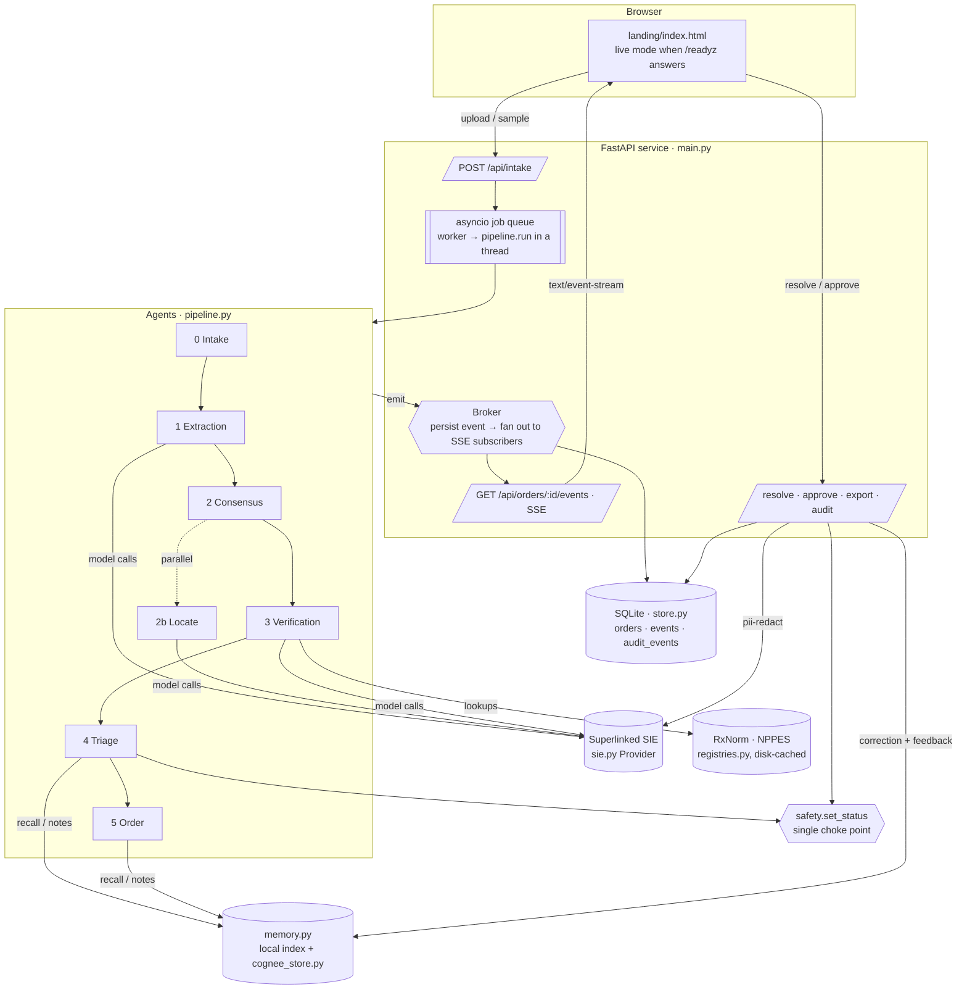
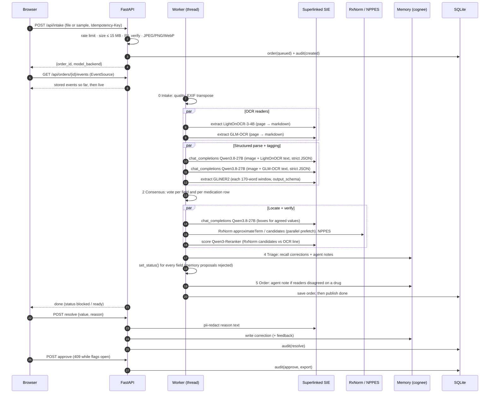
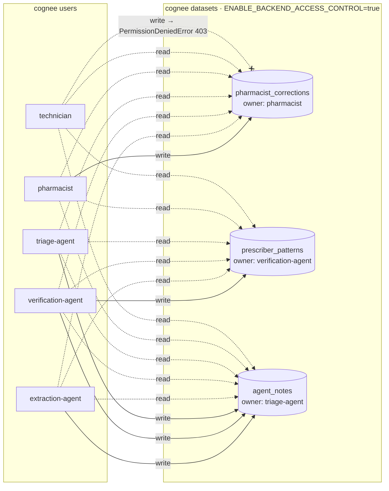
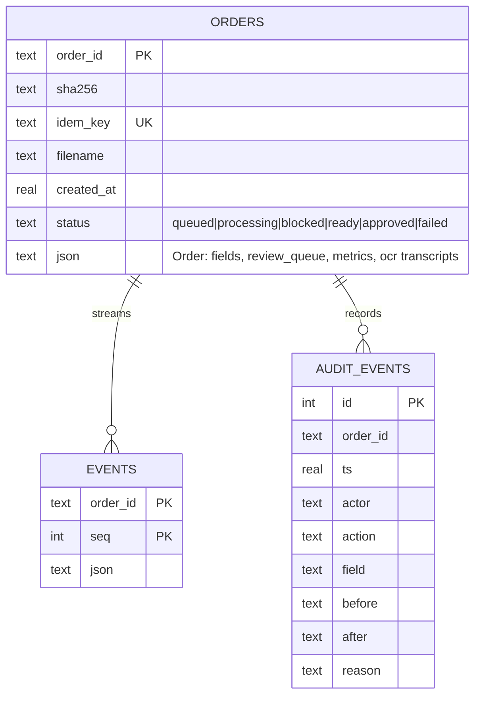

# PillSpark: detailed task architecture

This document describes what each agent does, which Superlinked SIE model or external service it calls, what it
emits, how cognee memory fits in, and how the safety invariant is enforced. File references are to `backend/app/`.

- [1. System overview](#1-system-overview)
- [2. Request lifecycle (sequence)](#2-request-lifecycle)
- [3. The six agents, task by task](#3-the-six-agents-task-by-task)
- [4. Consensus and confidence](#4-consensus-and-confidence)
- [5. Safety invariant](#5-safety-invariant)
- [6. Memory architecture (cognee)](#6-memory-architecture-cognee)
- [7. Pharmacist actions, audit and export](#7-pharmacist-actions-audit-and-export)
- [8. Event schema (what the UI renders)](#8-event-schema)
- [9. Data model](#9-data-model)
- [10. Failure policy](#10-failure-policy)
- [11. SIE integration notes](#sie-integration-notes)
- [12. Frontend](#12-frontend)

---

## 1. System overview



**Design rules**
1. **Every model is an open model on SIE, one line per job** (`backend/models.yaml`).
2. **Independent readers vote; nobody silently picks.** Disagreement becomes a reason the pharmacist sees.
3. **Only deterministic rules or a pharmacist can verify,** enforced in one function (`safety.set_status`).
4. **No patient identifier enters memory or logs.** Image bytes are never logged or put into events.
5. **Everything the pipeline does is an event:** persisted, streamed, and replayable for late subscribers.

---

## 2. Request lifecycle



---

## 3. The six agents, task by task

### 0. Intake agent: `agent_intake`
| | |
|---|---|
| **Input** | Image bytes (never logged) |
| **Tasks** | Decode; EXIF-transpose (so boxes match what the browser shows); sharpness (Laplacian variance), contrast and ink ratio to give a quality score |
| **Checks** | `quality`: pass when the score is ≥ 0.45, otherwise a flag ("expect more fields to need review") |
| **Events** | Document received; quality; "image bytes kept out of logs" |

### 1. Extraction agent: `agent_extraction` (Superlinked SIE)
| Task | SIE model | Call | Notes |
|---|---|---|---|
| Reader 1 | `lightonai/LightOnOCR-3-4B` | `extract(model, Item(images=[png≤2048px]))` returns a `markdown` entity | 7–9 s, 142 credits |
| Reader 2 | `zai-org/GLM-OCR` | same | 2–5 s, 25 credits; runs in parallel with reader 1 |
| Structured parse ×2 | `Qwen/Qwen3.8-27B-FP8` | `chat_completions` with a JPEG data URI plus **one** transcript and a strict `json_schema` | One pass per transcript, so the two votes are independent; 19–29 s each, in parallel |
| Order-field tagging | `fastino/gliner2-large-v1` | `extract(..., output_schema)` on 170-word windows (30-word overlap) | Implausible spans are dropped (e.g. an NPI without 10 digits, a body surface area without a number) |

Parse schema: per field `{value, present, legible, confidence, alternatives}` for order fields
(`patient_name, diagnosis, regimen, body_surface_area, prescriber_name, prescriber_npi`) and for each medication row
(`drug_name, dose, directions, date`). The prompt says: transcribe exactly, don't correct or guess, a signature is
not a legible name, and the image is the source of truth over the OCR text.

### 2. Consensus agent: `agent_consensus`
- **Order fields:** votes from both Qwen passes plus GLiNER2 spans. A tagger that found nothing abstains rather than voting "absent".
- **Medication rows:** aligned by row order across the two Qwen passes. A row one pass lacks counts as an "absent" vote. If the passes disagree on the number of rows, a flag event says so.
- **Each field records:** candidates with vote counts and sources; `agreement`; `agreeing_readers` (which OCR transcripts the winning value came from); the matching OCR line from each transcript (`evidence.ocr`); and a reason for every disagreement.

### 2b. Locate: `locate_fields` (Superlinked SIE, parallel with verification)
- **The call:** one `chat_completions` to Qwen3.8-27B, listing the agreed (or disputed) value of every field and asking for `[x1,y1,x2,y2]` boxes in 0–1000 coordinates with a strict schema. About 11 s and 270–290 credits.
- **Conversion:** boxes become percentages for the UI, and empty, tiny or whole-page boxes are discarded.
- **It's evidence only:** boxes show the pharmacist where to look. They never affect a status.

### 3. Verification agent: `agent_verification`
| Check | Source | Rule |
|---|---|---|
| RxNorm match | NLM RxNav `approximateTerm` (prefetched in parallel, disk-cached) | Similarity ≥ 0.85 is a match; otherwise a reason |
| Candidate ranking | `Qwen/Qwen3-Reranker-0.6B` via `score()` | Ranks up to 8 RxNorm candidates against the OCR line. **Ranking only**: adds candidates, never verifies |
| LASA (look-alike/sound-alike) | ISMP-style pairs incl. DAUNOrubicin ↔ DOXOrubicin / IDArubicin | Advisory if readings are unanimous and RxNorm confirms; otherwise a reason |
| Dose range | BSA-dosed table (daunorubicin 45–90, cytarabine 100–200 mg/m²/day) or single-dose table | No body surface area means **paused** (a reason, never skipped); out of range means a reason |
| Directions (sig) | Parser + cross-day comparison | ISMP error-prone abbreviations; differing infusion times for the same drug (24 h vs 22 h) |
| ISMP scan | Both transcripts | q.d., q.o.d., trailing zero, naked decimal, µg, IU |
| NPI | Luhn check with the 80840 prefix | No NPI on the document means a flag |
| NPPES | CMS NPI Registry | Needs a valid NPI or a full first + last name; ambiguous or not found means a reason |

### 4. Triage agent: `agent_triage` (cognee memory)
1. **Recall:** for drug, dose, prescriber and directions fields, recall matching records from `pharmacist_corrections` and `agent_notes`, ranked by feedback.
2. **Hints:** each hit adds a **"Seen before"** reason and a candidate, with the source record id.
3. **Proposals:** if memory's final value equals the current reading, a naive integration would verify it. The call `set_status(field, "verified", "memory")` raises `UnsafeVerification`, and the rejection is streamed.
4. **Dependency rule:** a dose or directions value whose line's drug is not confirmed gets a reason.
5. **Decision:** for each field:

   | Condition | Status |
   |---|---|
   | All readers absent | `missing` |
   | Unreadable, or reading confidence below 0.70 with disagreement | `unreadable` (value withheld) |
   | Agreement = 1.0, confidence ≥ 0.90, no reasons, and **two independent readers** | `verified` |
   | Anything else | `needs_review` |

### 5. Order agent: `agent_order`
- **Status:** `blocked` if any flag is open, otherwise `ready`.
- **Agent note:** if the readers disagreed on a drug name, the `extraction-agent` writes a failure note to `agent_notes`. It holds no patient data.
- **Done event:** carries metrics (SIE calls, credits, registry lookups, memory reads/writes, rejected self-verifications, per-call latency, guesses = 0).

---

## 4. Consensus and confidence

```
self_confidence = mean(model-reported confidence of the passes that agree with the winning value)
agreement       = winning votes / all non-abstaining votes
confidence      = 0.5 · self_confidence + 0.5 · agreement
                  × (0.6 + 0.4 · registry_score)      when a registry check ran
illegible vote  → confidence capped below 0.70
```

Thresholds come from the environment (`PILLSPARK_VERIFIED_MIN=0.90`, `PILLSPARK_REVIEW_MIN=0.70`).

---

## 5. Safety invariant

`safety.set_status(field, status, source)` is the only way a status changes:

```python
TRUSTED_VERIFIERS = {"triage_rules"}          # deterministic rules only
if status == "verified" and source not in TRUSTED_VERIFIERS: raise UnsafeVerification
if status == "resolved" and source != "pharmacist":          raise UnsafeVerification
if status == "verified" and field.reasons:                   raise UnsafeVerification
if status == "verified" and len(set(agreeing_readers)) < 2:  raise UnsafeVerification   # one reader can't verify
if status in ("unreadable", "missing"): field.value = None   # never display a guess as the value
```

Covered by `backend/tests/test_core.py`. Untrusted sources (memory, models, the reranker), the single-reader case,
open reasons, pharmacist-only resolution and value withholding are each tested. The end-to-end check fails if any
verified field lacks two agreeing readers.

---

## 6. Memory architecture (cognee)



**Configuration** (`cognee_store.configure_env`, set before cognee is imported):

| Setting | Value |
|---|---|
| LLM | `LLM_PROVIDER=custom`, `LLM_MODEL=openai/Qwen/Qwen3.8-27B-FP8`, `LLM_ENDPOINT=https://api.superlinked.com/v1` |
| Embeddings | `EMBEDDING_PROVIDER=openai_compatible`, `EMBEDDING_MODEL=BAAI/bge-m3`, `EMBEDDING_DIMENSIONS=1024`, same SIE endpoint |
| Access control | `ENABLE_BACKEND_ACCESS_CONTROL=true` |
| Stores | Under `data/cognee/` |
| Other | `IMPROVE_AUTO_ENABLED=false`, `COGNEE_SKIP_CONNECTION_TEST=true` |

**Setup:** `setup()`, then `create_user` for the five principals (internal ids `<name>@agents.pillspark.app`, never
emailed). Then `create_authorized_dataset(name, owner)`, and `give_permission_on_dataset(user, dataset.id, "read")` for
everyone else plus `"write"` for extra writers.

**Write path** (`Memory.write`, then `CogneeStore.remember`):
1. **Permission check:** the local check uses `WRITE_PERMS`; cognee checks again on `add`.
2. **PHI strip:** `strip_phi` removes every `patient*` field; free-text reasons first go through SIE `pii-redact` (in `main.resolve`).
3. **Local index:** an append-only JSONL file in `data/memory/`.
4. **cognee:** `cognee.add(text, dataset_id=..., user=<actor>, node_set=[field])`, waiting up to 6 s; if it takes longer it reports `cognee (queued)` and finishes in the background.
5. **Graph:** `cognee.cognify(datasets=[id], user=owner)` runs debounced (20 s of quiet), one at a time per dataset, with writes during a run triggering one more.

**Read path:** `Memory.recall(field, readings)` does a fuzzy match (≥ 0.85) against the raw readings of earlier
corrections and notes, skips retracted records, and ranks by feedback weight. Recall during a live run uses the local
index of the same PHI-stripped records, labelled "memory index" in events. cognee `recall` and `improve` over session
feedback are the planned next step.

**Feedback:** when a field with memory hints is resolved, a feedback record notes whether the suggestion was accepted.
Accepted records rank first; records ignored at least twice more often than accepted stop being suggested.
**Retraction:** `Memory.retract(id)` writes a retraction record, and recall skips the retracted one.

---

## 7. Pharmacist actions, audit and export

| Action | Rules | Writes |
|---|---|---|
| Resolve `POST /fields/{key}/resolve` | `X-Role: pharmacist` only (403 otherwise); non-empty reason (422); the field must be flagged (409) | `set_status(resolved, pharmacist)`; audit `resolve`; pii-redact; correction to memory (never for patient fields); feedback if memory hinted |
| Approve `POST /approve` | 409 while any field is flagged or the order is not `ready` | audit `approve` + `export` |
| Export `GET /export?format=` | Approved orders only | JSON, CSV, FHIR R4 `Bundle` (`type: collection`) of `MedicationRequest` (`status: active`, `intent: order`, `medicationCodeableConcept`, `subject`, `dosageInstruction` with a UCUM `doseQuantity`) |

`audit_events` is insert-only. Rows cover order creation, every field decision (`field_status`, with its source and
reasons), status changes, resolutions, approval and export.

---

## 8. Event schema

Each event is persisted (`events` table, increasing `seq`) and streamed as `data: {json}` over SSE. Late subscribers
first get stored events after `?after=seq`, then live ones. The stream closes after `type: "done"`.

```jsonc
{
  "seq": 17, "t": 7270,            // ms since the run started
  "type": "event",                 // event | stage | check | fields | regions | scan | done | audit
  "stage": 1,                      // 0 intake … 5 order
  "src": "sie",                    // sie | registry | rules | agent | memory | pharmacist
  "who": "extraction-agent",
  "model": "LightOnOCR", "model_id": "lightonai/LightOnOCR-3-4B",
  "ms": 7010, "credits": 142, "replayed": true,   // replayed only in mock mode
  "level": "ok",                   // ok | flag | block
  "msg": "LightOnOCR read 66 lines (1470 characters).",
  // type-specific: check: ["rxnorm","pass","7 matched"] · fields: [...] · regions: [[x,y,w,h],...]
  //                memory: "med2.drug_name" · op: "read"|"write" · status / metrics on done
}
```

---

## 9. Data model



`FieldResult` (in `schemas.py`) has these fields: `key, name, label, group, value, confidence, status, status_source,
reasons, candidates[{value, votes, sources}], evidence{readings, agreeing_readers, vote, ocr, boxes}, memory[],
agreement, self_confidence, registry_score, resolved_value, resolved_by, resolution_reason`.

---

## 10. Failure policy

| Failure | Behaviour |
|---|---|
| One OCR reader fails | Continue with the other. Nothing can verify (one reader), so everything goes to review |
| One Qwen parse fails or truncates | Explicit event ("structured output was truncated"); single-reader fields can't verify |
| All parses fail, or SIE is unreachable | Every field `unreadable` with "every field needs review"; order `blocked`. **Never a guess** |
| RxNorm or NPPES unreachable | The check is reported as unverifiable, never as passed (8 s timeout, disk cache) |
| cognee slow or unavailable | The local memory index still works; events name the store actually used |
| SIE call error | One retry with backoff (the SDK also retries 429/503); then a model-unavailable event |
| Upload problems | 413 too large · 415 not an image or wrong type · 429 rate limit · duplicate `Idempotency-Key` returns the same order |

---

## SIE integration notes

- **Client:** `SIEClient(api_key, base_url="https://api.superlinked.com", timeout_s=180)`, with `provision_timeout_s` on every call to ride out cold starts.
- **OCR models** (`LightOnOCR-3-4B`, `GLM-OCR`): the reply's `entities` hold one `{label: "markdown"}` item with `bbox: null`. There are no coordinates.
- **`docling:ocr`** returns per-text bounding boxes, but it missed key handwritten lines on the demo chart, so it isn't used.
- **Qwen3.8-27B-FP8 context:** 8,192 tokens total; an image is charged about 3,136 tokens regardless of resolution; the output cap is 4,096. The parse uses `max_completion_tokens=2800` and a transcript of at most 4,500 characters. Locate uses 1,500.
- **Strict JSON:** `response_format={"type":"json_schema","json_schema":{..., "strict": true}}` works on Qwen3.8-27B. `GLM-5.3-Flash` rejects it ("does not declare 'json_schema' grammar support").
- **GLiNER2:** an empty result arrives as HTTP 500 with "Inference completed without a valid conserved billing settlement". It's treated as an empty result.
- **Credits:** read from `request.usage.credits_charged` and shown per call in the activity feed and summed in monitoring.
- **Offline replay:** with `PILLSPARK_RECORD=1`, live outputs are recorded to `backend/fixtures/<sha>.json`, keyed by job, model and an input hash. The parse key includes a schema/prompt version so a stale recording is never replayed against a new schema.

---

## 12. Frontend

`landing/index.html` is a single file with no build step:
- **Live mode** (served by the backend and `/readyz` answers):
  - **Intake:** a drop zone and "Process sample chart". Runs aren't auto-started, since each one spends SIE credits.
  - **Stream:** an `EventSource` stream drives the stage strip. Each stage highlights in its owner's color: SIE indigo for extraction, cognee magenta for triage.
  - **Panels:** the activity feed has source badges; the checks, monitoring (calls, credits, latency bars, guesses = 0) and audit panels fill from the server.
  - **Fields:** grouped by order and medication line, with OCR snippets, candidate chips, "Enter value… (reason required)", and J/K/Enter shortcuts.
  - **Boxes:** the selected field's box is drawn on the chart in its status color.
  - **`?autorun=sample`** starts a run on load, for tests and kiosk demos.
- **Static mode** (opened as a file): a scripted, clearly labelled replay of the same flow.
- **Checks:** `landing/scripts/verify.mjs` checks static content, image redaction, the replay, the pharmacist flow, and a real live intake in headless Chrome.
